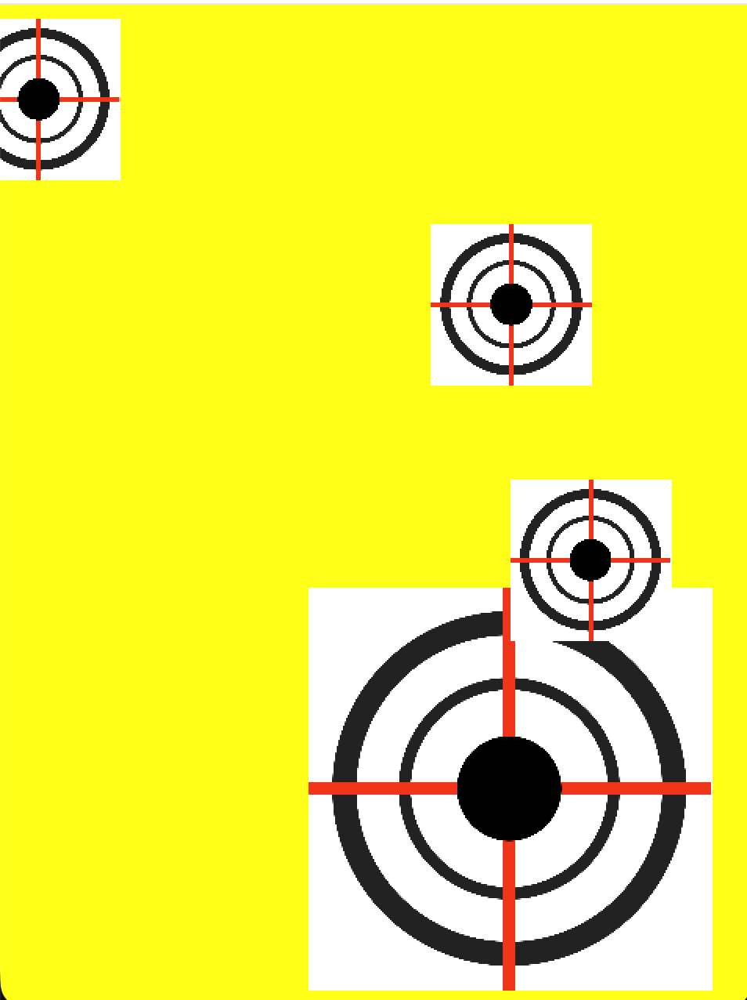

````markdown
# Shooter

A small 2D shooter written in C++17 with OpenGL 4.1 core, SDL2, GLM, and GLAD. Move the player, shoot falling enemies, and keep your score above zero.




## Controls

| Arrow keys -> Move the player |
| Space -> Fire (held fire, limited by a cooldown) |
| Close window -> Quit 

## Rules

Each enemy destroyed by a bullet adds **2** points.
An enemy touching the player costs **1** point.
When the score drops below zero, the game ends. The window title shows "Game Over".

## Build

Requirements: CMake 3.16+, a C++17 compiler, SDL2, and GLM. On macOS with Homebrew:

```bash
brew install sdl2 glm
```

Build and run from the project root:

```bash
cmake -S . -B build
cmake --build build
./build/shooter
```
Run from the project root so the relative `shaders/` and `assets/` paths resolve.

## Project structure

```
src/        game source (main, Game, Player, Enemy, Bullet, Shader, Mesh, Texture)
include/    GLAD and KHR headers, stb_image.h
shaders/    vertex and fragment shaders
assets/     textures
```

## Architecture

**Entities.** `Entity` is an abstract base with virtual `Update` and `Draw`, plus a shared alive flag (`IsAlive`, `Kill`) and an axis-aligned bounding box (`GetBounds`). `Player`, `Enemy`, and `Bullet` derive from it.

**Ownership.** `Game` owns all entities through `std::unique_ptr`. `Player` is added to the game with `AddEntity`, and `Game` keeps a non-owning `Player*` for firing. `Shader` and `Texture` are created in `main()`, and entities borrow them by reference. Cleanup resets `Game` before the shader and texture, so borrowers are destroyed first.

**Resource management.** `Shader`, `Mesh`, and `Texture` are RAII wrappers around OpenGL handles. Each is move-only: copying is deleted, and moving transfers the handle and zeroes the source, so a handle is released exactly once.

**Game loop.** The main loop uses a fixed timestep of 1/60 s with an accumulator. Frame time is clamped to 0.25 s so a long stall does not cause a burst of updates. Input is read once per frame, and updates run in fixed steps.

**Update order.** Each frame, `Game` spawns and fires, updates all entities, checks bullet-enemy and enemy-player overlaps with AABB tests, then removes dead entities with the erase-remove idiom.

## BUGS I fixed

**Segmentation faults**

main() called gGame->SetWindow() and gGame->SetQuad() before gGame existed. I ran command lldb ./build/shooter and run. The debugger showed EXC_BAD_ACCESS inside a Game method, with the address being a small offset (0xa40, 0xa50). A small address means a method was called on a null object, and the offset is a member inside that object.
The fix was an ordering rule: create the object first, then call its methods.

**Circular dependencies**

Game.hpp includes Player.hpp and Enemy.hpp, and the entity headers all include Entity.hpp. Adding a type to one header can make another fail to compile.
Fixes that helped: #pragma once on every header, forward declarations (class Shader;) where only a pointer or reference is needed, and putting includes in .cpp files where the full type isn’t needed.
Lesson: a header should include only what its declarations require. Full types are needed for members by value and for unique_ptr destruction, but pointers and references can use a forward declaration.

**Pointer ownership**

Game owns entities through unique_ptr. Player, Enemy, and Bullet borrow the shader, texture, and mesh through const T*. Game also keeps a non-owning Player* for firing.
The dangerous case is teardown order. Borrowers must be destroyed before the objects they borrow from, which is why Cleanup() resets gGame first, then textures, then the shader and quad.
Lesson: decide who owns each object in writing (the README table helps), and make borrowers hold raw pointers or references, never unique_ptr.

## Tree 
.
├── assets
│   ├── enemy.png
│   └── screenshot.png
├── CMakeLists.txt
├── commands.txt
├── episodes
│   ├── main
│   └── main.cpp
├── include
│   ├── bullet.hpp
│   ├── camera.hpp
│   ├── enemy.hpp
│   ├── Entity.hpp
│   ├── Game.hpp
│   ├── glad
│   │   └── glad.h
│   ├── KHR
│   │   └── khrplatform.h
│   ├── Mesh.hpp
│   ├── player.hpp
│   ├── Shader.hpp
│   ├── stb_image.h
│   └── Texture.hpp
├── readme.md
├── shaders
│   ├── frag.glsl
│   └── vert.glsl
└── src
    ├── bullet.cpp
    ├── camera.cpp
    ├── enemy.cpp
    ├── Game.cpp
    ├── glad.c
    ├── main.cpp
    ├── mesh.cpp
    ├── player.cpp
    ├── Shader.cpp
    └── texture.cpp

add any source files to src/, headers to include/, use commands.txt for reference.
## What this project demonstrates

Modern C++: `unique_ptr`, move semantics, RAII, `override`, virtual destructors, and `std::remove_if` with erase.
Game programming: a fixed-timestep loop, input handling, AABB collision, spawning on a timer, and a simple game state.
OpenGL: VAO, VBO, and IBO setup, GLSL shaders with uniforms, textures with stb_image, and per-object model matrices.
````
